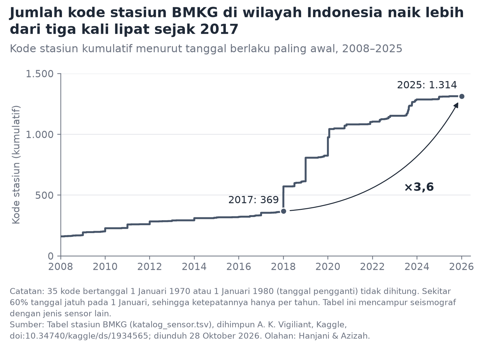

# Gambar yang kami buang

**Alasan dibuang:** Gambar ini tampak membuktikan jaringan makin rapat, tetapi tabelnya mencampur seismograf dengan sensor jenis lain, tanggalnya bukan tanggal pemasangan, dan angkanya berbeda dengan jumlah sensor yang disebut BMKG. Gambar ini akan memindahkan perdebatan ke soal berapa jumlah alat, yang tidak bisa dijawab data ini. Kami menggantinya dengan Gambar 4, yang memakai ukuran dari katalog itu sendiri.

_Text verbatim from `docs/figure-text.md` (F-X); written by the group._
